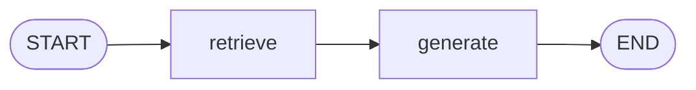

# langchain-rag

Separate learning repo for **Phase 7** themes that do not belong in
[`langchain-first-chain`](../langchain-first-chain):

- RAG / vector stores / document chunking
- LangGraph `retrieve` → `generate` + local Studio (`langgraph.dev`)
- Optional later: Agent Server deploy, product UI, Postgres checkpointers

## Prerequisites

- [uv](https://docs.astral.sh/uv/)
- [Ollama](https://ollama.com) running locally

```bash
ollama pull llama3.2
ollama pull nomic-embed-text
```

## Setup

```bash
uv sync --group dev
```

## 1. Starter RAG (LCEL, no graph)

```bash
uv run python rag.py                 # interactive Q&A (reuses .chroma)
uv run python rag.py --rebuild       # re-index data/ then chat
uv run python rag.py -q 'What is RAG?'   # one-shot only when you pass -q
```

Pipeline: load `data/*.md` → split → embed with Ollama → Chroma (`.chroma/`) → answer.
After you edit files under `data/`, use `--rebuild` once so the index picks them up.

## 2. LangGraph RAG (retrieve → generate)

```bash
uv run python graph_chat.py
uv run python graph_chat.py --rebuild
uv run python graph_chat.py -q 'What is RAG?'
```

Same Chroma index; the turn is two nodes so you can inspect them in Studio.

Answers use inline `[n]` cites when the model quotes a chunk, plus a fixed
`Sources:` footer (filename + preview) appended in Python — not invented by the LLM.



## 3. Studio (`langgraph.dev`)

```bash
uv sync --group dev
uv run langgraph dev
```

- API default: `http://localhost:2024`
- Graph name in Studio: **`rag`** (`langgraph.json` → `graph_server.py:graph`)
- Send a human message; watch `retrieve` then `generate`
- Do **not** attach SqliteSaver in `graph_server.py` (API owns persistence)

Windows note: `colorama` is in the `dev` group so Studio logging works.

## Env

Optional (see `.env.example`): `OLLAMA_MODEL`, `OLLAMA_EMBED_MODEL`, `RAG_RETRIEVE_K`.

Default is always the interactive loop. A leftover PowerShell `$env:RAG_QUERY` is **ignored**
unless you pass `-q`. Clear it with `$env:RAG_QUERY = $null` if you want.

## Layout

| Path | Role |
|------|------|
| `index_store.py` | Shared load / Chroma helpers |
| `rag.py` | LCEL RAG demo (no LangGraph) |
| `graph_rag.py` | StateGraph: retrieve → generate |
| `graph_server.py` | Studio export (`langgraph.json`) |
| `graph_chat.py` | CLI for the graph |
| `langgraph.json` | `langgraph.dev` config |
| `data/` | Source documents to index |
| `.chroma/` | Persistent Chroma index (gitignored) |
